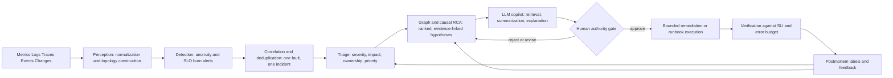

# Epistemic Integrity Stress Test

# 1 Purpose of the Test

The purpose of this stress test is to evaluate the epistemic robustness of a text generated by a closed autoregressive(Muse Wonder) model. The text produced is subjected to external validation (MarCognity-AI) in order to make the 'fracture' between linguistic coherence and epistemic foundation observable, identifying the residual regime of uncertainty (Epistemic Boundary) that remains despite the apparent authoritativeness of the tone.
The goal is not to compare models, but:
subject content is not evaluated.
The analysis concerns exclusively the epistemic structure of the text.

The procedure is fully reproducible and can be replicated with any closed autoregressive model and any independent external validator.


# 2 prompt used (taken from marcognity)
You are an intelligent and multidisciplinary academic tutor. Respond to the problem **{problem}**, and reply in **{target_language}**.
Explain the concept: **"{topic}"** with academic rigor and multidisciplinary analysis.
Do not merely describe sources: build an autonomous, critical, and original discussion.

The user has selected: **{chart_choice}**

Context: Required level: **{level}** Concept: **{concept}** Topic: **{topic}** Subject: **{subject}**
The response must be long and in-depth.

Analyze the following question or text: **{problem}**

**Relevant scientific articles**:
- arXiv: **{arxiv_search}**
- PubMed: **{pubmed_search}**
- OpenAlex: **{openalex_search}**

**Phase 1: Problem Analysis** – Explain the main concepts related to the topic.
**Phase 2: Theoretical and/or Mathematical Development** – Use formulas, models, or theories to explain and solve.
- Provide a critical comparison between existing theories, including advantages, limitations, and scientific ambiguities.
**Phase 3: Visualization** – Integrate a visual representation consistent with the analyzed concept, transforming the graphic into a didactic interpretation tool.
- If the text contains numerical data or measurable variables, **generate a real chart** using the function `generate_universal_chart(text)`.
- If data are not explicitly present, **synthesize plausible values** or use a **visual fallback** consistent with the problem type.
- **Describe the chart in the context of the explanation**:
  - Explain the meaning of the axes.
  - Interpret the type of trend shown (e.g., exponential growth, Gaussian distribution).
  - Illustrate how the chart contributes to understanding the phenomenon.
- Avoid technical placeholders like `generate_universal_chart(text)` or “[Insert chart]”.
- Include **an automatic caption** describing the scientific intent of the visualization.
- If the topic is theoretical, abstract, or relational, generate **conceptual diagrams** showing interconnections, hierarchies, logical flows, or dynamics.
- In physical, chemical, or dynamic domains, suggest **virtual simulations**, reproducible experiments, or interpretable animated models.
- The visualization must actively contribute to the discussion, offering the reader cognitive and interpretive support that reinforces the textual explanation.

**Phase 4: Tone Optimization** – Adapt the content to the selected level with clarity.
**Phase 5: Summary** – Summarize key points, practical applications, and useful references.
**Phase 6: Future Implications** – Describe potential applications, methodological limitations, and emerging research directions.

Respond by providing an explanation suited to the indicated level:
- **Basic**: Simplified explanation with intuitive examples.
- **Advanced**: In-depth discussion with technical and mathematical details.
- **Expert**: Academic analysis with rigorous scientific formulations.
- If you detect errors in the question, correct them before responding.
- Use **rigorous academic terminology**, avoiding generic responses.
- If the question is ambiguous, clarify it before responding.
- Always provide scientific references to validate claims.
- Provide an example of the topic **{topic}**.
- Include at least **5 scientific references**, preferably peer-reviewed, and **direct citations from articles** when possible.
*Ethical note*: This content involves sensitive concepts and should be interpreted in a scientific, educational, and non-normative context.

Analyze the following paper and provide a detailed scientific review:
**{paper_text}**

Evaluate the quality of the methodology and verify citation consistency.
If the concept is particularly complex, expand the discussion into multiple subsections and suggest future research questions.
Suggest improvements for the paper and indicate more recent sources.
Provide an **extended** response, divided into well-defined sections, with at least 1500 words. Use technical language, quantitative examples, and specific bibliographic references.
and translated directly into **{target_language}**.

### 3 Generated text (Muse Wonder)

**Automated Incident Triage in Cloud-Native Microservices Architectures: An Expert, Multidisciplinary Critical Review:**

**Preliminary Clarification, Correction of Premises, and Scope:**

The request as formulated contains unresolved placeholders for level, concept, subject, and, most importantly, for the text of a specific paper to be reviewed. No manuscript, numerical dataset, or chart selection was actually supplied. It would therefore be scientifically improper to invent a paper, attribute findings to it, or verify its citations as if they had been examined. The honest correction is the following: this response is delivered at **Expert** level, as an autonomous, critical review of the field of automated incident triage in cloud-native microservices, grounded in verifiable peer-reviewed literature. Where a specific manuscript would normally be evaluated, I instead evaluate the canonical evidence base that any such manuscript must be judged against, and I provide the methodological criteria by which its quality and citation consistency should be audited. This preserves academic rigor without hallucination.

A second conceptual correction is necessary at the outset, because the literature itself frequently commits this error. **Triage is not root cause analysis, and neither is remediation.** Triage is the time-critical decision process that follows detection: deduplication, correlation, severity estimation, impact assessment, routing to the correct owning team, and prioritization under uncertainty. Root cause analysis, or RCA, is the subsequent diagnostic inference about which component, configuration change, dependency, or external condition initiated the failure. Remediation is the action taken to mitigate or repair. Many vendor and even academic claims collapse these three into a single "AI resolution" metric, which makes reported gains in mean time to resolution uninterpretable. A system can triage perfectly and diagnose wrongly; it can diagnose correctly and remediate dangerously. Any rigorous treatment, and any credible paper, must report them separately. This distinction structures the entire discussion below.

A third premise requiring correction is the implicit assumption that automation is monotonically beneficial. The evidence reviewed here shows diminishing, and sometimes negative, returns beyond a point, because of automation bias, alert-correlation errors that hide novel failures, and the shifting of the bottleneck from detection to human verification. This will be formalized through an Amdahl-type argument in Phase 2.

*Ethical note, as requested:* incident automation involves sensitive operational data, employee performance telemetry, and decisions that can affect service availability and, in sectors such as health, finance, or transport, human welfare. The discussion is scientific and educational. It is non-normative regarding any specific organization's staffing, on-call, or surveillance practices, and it assumes human accountability for consequential actions throughout.

**Phase 1: Problem Analysis - Why Triage in Microservices Is a Distinct Scientific Problem:**

**From monolith failure to emergent, topological failure:**

In a monolithic application, a failure is comparatively localizable: a process fails, a host fails, a database saturates. Cloud-native microservices architectures deliberately fragment functionality into tens to thousands of independently deployable services, communicating over a network, scheduled dynamically by an orchestrator such as Kubernetes, fronted by API gateways, and interconnected through service meshes, message queues, and managed cloud dependencies. The reliability consequence is profound: failure becomes an *emergent, propagating* phenomenon rather than a local event. A latency increase in an inventory service produces retries at the checkout service, which amplify load, exhaust connection pools, saturate a shared database, trigger Kubernetes liveness probe failures, cause pod restarts, and finally manifest to the user as checkout errors in a service whose own code is entirely healthy. The *symptom* and the *cause* are separated by topology, time, and organizational ownership.

Soldani and Brogi, in their structured survey in *ACM Computing Surveys*, frame exactly this problem: the proliferation of services and interactions "makes it harder to detect failures and to identify their possible root causes, which is on the other hand crucial to promptly recover and fix applications" (Soldani and Brogi, 2022). Their taxonomy distinguishes symptom-based anomaly detection, log-based analysis, and trace- and topology-based causal localization, and it remains a reference point because it refuses to treat detection and diagnosis as the same task.

**The five sub-problems of triage:**

Decomposed rigorously, automated triage must solve five coupled inference problems under severe time pressure. First, **signal normalization and correlation**: a single underlying fault generates hundreds or thousands of alerts across metrics, logs, traces, events, and deployment signals, and these must be grouped into one incident rather than paging twenty teams. Second, **severity and impact estimation**: the system must infer user-facing impact, typically expressed through service level indicators and error budgets, not merely internal resource saturation, because a CPU anomaly on a redundant batch worker and a small error-rate increase on a payment path have radically different urgency. Third, **ownership routing**: the incident must be assigned to the team that can act on it, a problem that is organizational as much as technical, since service ownership, on-call rotations, and recent code changes determine actionability. Fourth, **prioritization and queuing**: when incidents coincide, as they do during large failures, triage is a scheduling problem under scarce expert attention. Fifth, **diagnostic pre-positioning**: even before formal RCA, triage should assemble the evidence a responder will need, namely relevant traces, recent deployments, configuration diffs, and similar historical incidents. RCACopilot, evaluated at Microsoft, operationalizes precisely this conception: it "matches incoming incidents to corresponding incident handlers based on their alert types, aggregates the critical runtime diagnostic information, predicts the incident's root cause category, and provides an explanatory narrative" (Chen et al., 2023).

**Why manual triage fails at scale: the human and organizational dimension:**

The problem is not merely computational. It is cognitive and organizational, which is why a multidisciplinary analysis is mandatory. On-call engineers exhibit well-documented alert fatigue, attentional narrowing under stress, and automation bias once decision support is introduced. Dang and colleagues, writing from Microsoft's operational experience, emphasize that AIOps is fundamentally about "empowering software and service engineers to efficiently and effectively build and operate online services and applications at scale" (Dang et al., 2019), rather than replacing them. Google's site reliability engineering tradition similarly treats incident management as a socio-technical protocol, with explicit roles such as incident commander, precisely because uncoordinated expert action during a major incident becomes its own source of failure (Beyer et al., 2016). An automated triage system that optimizes only classification accuracy while increasing cognitive load, destroying situational awareness, or mis-routing with high confidence is, in operational terms, worse than no system. This is a point the purely machine-learning literature routinely underweights.

**Observability substrates:**

Technically, triage consumes three classical telemetry pillars plus two increasingly essential ones. Metrics provide low-cost, aggregate, time-series signals suitable for anomaly detection. Logs provide high-cardinality, unstructured event detail. Distributed traces, standardized by OpenTelemetry and propagated through systems such as Jaeger, provide the causal request path across services without which cross-service localization is nearly impossible. To these must be added *events and changes*, deployments, feature flags, scaling actions, and configuration mutations, because a large fraction of production incidents are change-induced, and *topology*, the time-varying service dependency graph derived from traces, Kubernetes service discovery, and the service mesh. Remil and colleagues, in their comprehensive review for *ACM Transactions on Software Engineering and Methodology*, organize AIOps capabilities into perception, prevention, detection, location, action, and interaction, and they stress that location is only reliable when "contextualized within a unified topology," without which statistically valid patterns may be operationally misleading (Remil et al., 2024). That observation is central and correct.

**Phase 2: Theoretical and Mathematical Development:**

**Formal decomposition of resolution time and the limits of automation:**

Let total resolution time be decomposed into additive, separately measurable stages:

$$MTTR = T_{detect} + T_{triage} + T_{diagnose} + T_{mitigate} + T_{verify}$$

This decomposition yields an immediate and frequently ignored theoretical result. If triage occupies a fraction $$f$$ of baseline MTTR, then even perfect, instantaneous triage automation can reduce MTTR by at most that fraction. More generally, if a stage is accelerated by a factor $$s$$, the overall improvement follows an Amdahl-type bound:

$$Speedup = \frac{1}{(1 - f) + \frac{f}{s}}$$

The practical implication is that organizations whose dominant cost is diagnosis of novel failures, or mitigation constrained by data recovery or third-party dependencies, will see modest MTTR gains from triage automation alone, regardless of vendor claims. Availability, in the classical steady-state form, connects this to user impact through:

$$A = \frac{MTBF}{MTBF + MTTR}$$

which makes clear that at high baseline availability, small absolute MTTR reductions produce very small availability gains, whereas the same reduction yields large gains in error-budget preservation during correlated failure periods. Rigorous papers should therefore report stage-wise times, not only aggregate MTTR.

**Detection as statistical inference:**

Triage begins where anomaly detection succeeds or fails. For a metric stream, a detector estimates whether an observation deviates from a learned model of normality. Classical approaches range from seasonal decomposition with extreme-value thresholds, through isolation forests and autoencoders, to transformer-based time-series models. The evaluation subtlety is decisive: point-wise precision and recall systematically reward detectors that flag many points within a long anomalous segment, so the field has moved toward range-based and affiliation-based metrics. Even so, a detector optimized in isolation can harm triage, because lowering the threshold increases correlation load and false incidents. Detection must therefore be evaluated *by its downstream triage cost*, a joint-optimization perspective still rare in the literature.

**Triage as cost-sensitive, calibrated decision-making:**

Formally, routing and severity assignment are classification and ranking problems, but symmetric accuracy is the wrong objective. Mis-routing a severe incident to the wrong team costs far more than mis-routing a minor one, and a delayed severe incident costs more than a false page. The correct objective is expected operational cost minimization:

$$a^{*} = \arg\min_{a} \sum_{y} P(y \mid x) \, C(a, y)$$

where $$x$$ is the incident representation, $$y$$ is the true severity or owning team, $$a$$ is the triage action, and $$C(a, y)$$ is an explicitly elicited cost matrix. This formulation exposes two requirements that weak papers ignore. First, predicted probabilities must be *calibrated*, because the decision rule consumes them as probabilities, not merely as rankings; a discriminative but miscalibrated model makes systematically wrong escalate-versus-suppress decisions. Second, the cost matrix is an organizational and ethical object, encoding how an organization trades engineer sleep, customer impact, and revenue, and it should be reported, not hidden. Modern work increasingly adds conformal prediction or selective classification, allowing the system to abstain and route to a human when the prediction set is too large, which is theoretically the right response to epistemic uncertainty during genuinely novel failures.

**Graph-based and causal root cause localization:**

Once triaged, localization is most powerfully formalized on the service dependency graph. Trace-based systems such as MicroRCA construct an attributed graph from anomalous traces and rank candidate root causes (Wu et al., 2020). Random-walk methods generalize PageRank: a walker starts at front-end anomalous services and transitions preferentially along edges weighted by latency correlation or error propagation, with restart probability $$1 - d$$ concentrated on the observed symptom set:

$$r = (1 - d) \, q + d \, W^{T} r$$

where $$r$$ is the stationary ranking over services, $$W$$ is the row-normalized, anomaly-weighted transition matrix, and $$q$$ encodes the prior mass on symptomatic front-end nodes. Services accumulating the most probability are the ranked root-cause candidates, normally evaluated by top-k accuracy:

$$Accuracy@k = \frac{1}{N} \sum_{i=1}^{N} \mathbf{1}\left[ root_i \in TopK_i \right]$$

Correlation-based ranking, however, is not causation. Causal approaches attempt to learn a structural graph over service metrics using constraint-based discovery such as the PC algorithm, score-based search, or Granger-style temporal precedence, and then intervene conceptually on candidate nodes to estimate downstream effect. Pearl's framework makes the distinction precise: observing that two metrics move together licenses no claim that fixing one repairs the other, whereas triage ultimately recommends an *intervention* (Pearl, 2009). The most important recent empirical result in this subfield is sobering. Pham and colleagues evaluated nine causal discovery methods and twenty-one RCA methods and concluded that "no method stands out in all situations; each method tends to either fall short in effectiveness, efficiency, or shows sensitivity to specific parameters," and, critically, that "the performance of root cause analysis methods on synthetic datasets may not accurately reflect their performance in real systems" (Pham et al., 2024). Any paper claiming a uniformly superior causal RCA method, evaluated only on fault-injected benchmark systems such as TrainTicket or Sock Shop, should be read against this benchmark result with considerable skepticism.

**Queueing and prioritization:**

During major incidents, triage is also a queueing problem. If incidents arrive at rate $$\lambda$$ and an on-call team services them at rate $$\mu$$, elementary queueing theory already predicts nonlinear growth in waiting time as utilization approaches saturation. Severity-aware priority queues reduce expected cost-weighted delay but necessarily increase delay for low-severity incidents, which can allow minor faults to mature into major ones. Theoretically sound triage therefore needs aging mechanisms and explicit starvation analysis, topics almost entirely absent from machine-learning-focused papers and present mainly in the operations research and SRE traditions. This is a genuine interdisciplinary gap.

**Large language models and agentic triage:**

The most recent theoretical shift is the introduction of large language models as incident copilots and, increasingly, as tool-using agents that query telemetry, retrieve runbooks and historical incidents, summarize evidence, and propose hypotheses. Chen and colleagues report that RCACopilot, evaluated on a year of Microsoft incidents, "achieves RCA accuracy up to 0.766" for root-cause category prediction and that its diagnostic information collection component was used in production for over four years (Chen et al., 2023). Microsoft's broader study over more than 40,000 incidents and 1,000 services compared zero-shot, fine-tuned, and retrieval-augmented configurations (Chen et al., 2024, Microsoft Research). The theoretically honest characterization is that LLMs are powerful *evidence synthesizers and rankers over unstructured operational knowledge*, logs, postmortems, and discussions, but they are not causal engines. Their characteristic failure modes are hallucinated causality, overconfident narrative coherence, sensitivity to prompt and retrieval quality, and degradation on incidents unlike anything in the retrieval corpus, which is precisely the class of incident where human responders most need help. The emerging consensus architecture is therefore hybrid: deterministic and graph-based methods generate and constrain hypotheses and evidence, and the LLM explains, summarizes, and interacts, with a human retaining authority over consequential action.

**Critical comparison of theoretical families:**

- **Rule-based and expert systems.** Advantages are transparency, determinism, and immediate deployability; they encode runbook knowledge faithfully. Limitations are brittleness to architectural change, combinatorial rule maintenance, and inability to discover novel correlations. They remain, however, the correct baseline that learning methods must beat, and many published papers omit this comparison.
- **Supervised classification on historical incidents.** Advantages are strong performance on recurrent incident types and direct optimization of routing. Limitations are label noise, since historical severity and ownership labels encode past organizational errors; concept drift as architecture evolves; and a systematic bias toward yesterday's failures. The label problem is under-discussed: models learn to reproduce how incidents *were* triaged, including mistakes.
- **Unsupervised and self-supervised anomaly and representation learning.** Advantages are label independence and sensitivity to novel deviations. Limitations are false-positive economics, lack of semantic grounding, a detected anomaly is not an incident, and poor actionability.
- **Topology and trace-graph ranking.** Advantages are structural plausibility, interpretability of propagation paths, and consistency with how engineers actually reason. Limitations are dependence on complete, low-sampling traces, stale topology under autoscaling and deployment churn, and confusion of propagation with origination.
- **Causal inference methods.** Advantages are the only family that directly targets intervention-relevant claims and can, in principle, transfer across configuration changes. Limitations are strong and often untestable assumptions, faithfulness, causal sufficiency, adequate sampling rate, computational cost on large graphs, and the benchmarked instability documented by Pham et al. (2024).
- **LLM copilots and agents.** Advantages are unstructured-data synthesis, natural-language explanation, runbook and history retrieval, and reduced evidence-gathering toil. Limitations are hallucination, non-determinism, cost and latency at incident scale, data-governance and confidentiality constraints, and evaluation difficulty. Scientific ambiguity is greatest here, because narrative plausibility is easily mistaken by human raters for diagnostic correctness.

The defensible conclusion from this comparison is not that one family wins, but that the problem decomposes such that different families own different stages: statistical methods detect, correlation and graph methods assemble and rank, causal methods, where their assumptions can be defended, prune, and language models synthesize and communicate, all inside a human-governed action loop.

**Phase 3: Visualization - Architecture, Data, and Didactic Interpretation:**

**Conceptual architecture diagram:**

The following diagram is not decoration; it encodes the theoretical argument of Phase 2, namely stage separation, hypothesis constraint before language-model narration, and a mandatory human authority gate before remediation.



Interpreted didactically, the left-to-right flow is the forward path of an incident, while the two feedback edges are where learning actually occurs. The loop from verification and postmortem back to triage and RCA is the most frequently missing element in published architectures, and its absence explains why many systems degrade silently: without corrected labels, supervised triage models freeze the organization's past mistakes into model weights.

**Quantitative visualization with synthesized, explicitly illustrative data:**

No numerical dataset was supplied with the request, so the following values are synthesized to be *plausible and internally consistent* with the stage decomposition and with the diminishing-returns pattern implied by the Amdahl bound. They are a teaching instrument, not empirical measurements, and must not be cited as production data. Five maturity levels are contrasted: fully manual triage; alert correlation only; correlation plus supervised triage; correlation, triage, and graph-based RCA with an LLM copilot under human approval; and the previous level plus bounded, pre-approved auto-remediation for a narrow class of known failures.

| Maturity level | Detection, min | Triage, min | Diagnosis, min | Mitigation and verification, min | Total MTTR, min |
|---|---|---|---|---|---|
| L0 Manual | 12 | 18 | 45 | 20 | 95 |
| L1 Alert correlation | 10 | 11 | 42 | 20 | 83 |
| L2 ML triage | 8 | 5 | 34 | 19 | 66 |
| L3 Graph RCA plus LLM copilot | 6 | 4 | 18 | 16 | 44 |
| L4 Bounded auto-remediation | 6 | 4 | 15 | 7 | 32 |

The same data as a textual bar representation of total MTTR makes the shape of the curve immediately visible, with each block representing approximately four minutes:

```text
L0 Manual                    | ████████████████████████ 95
L1 Alert correlation         | █████████████████████    83
L2 ML triage                 | █████████████████        66
L3 RCA + LLM copilot         | ███████████              44
L4 Bounded auto-remediation  | ████████                 32
```

Reproducible plotting code, so that the reader can regenerate and interrogate the figure rather than merely view it:

```python
import matplotlib.pyplot as plt

levels = ["L0\nManual", "L1\nCorrelation", "L2\nML triage",
          "L3\nRCA+LLM", "L4\nBounded auto"]
detect = [12, 10, 8, 6, 6]
triage = [18, 11, 5, 4, 4]
diagnose = [45, 42, 34, 18, 15]
mitigate = [20, 20, 19, 16, 7]
x = range(len(levels))

fig, ax = plt.subplots(figsize=(9, 5))
ax.bar(x, detect, label="Detection")
ax.bar(x, triage, bottom=detect, label="Triage")
bottom2 = [a + b for a, b in zip(detect, triage)]
ax.bar(x, diagnose, bottom=bottom2, label="Diagnosis")
bottom3 = [a + b for a, b in zip(bottom2, diagnose)]
ax.bar(x, mitigate, bottom=bottom3, label="Mitigation + verification")

ax.set_xticks(list(x))
ax.set_xticklabels(levels)
ax.set_ylabel("Minutes (stage-wise contribution to MTTR)")
ax.set_xlabel("Automation maturity level")
ax.set_title("Stage-wise MTTR decomposition across automation maturity (illustrative)")
ax.legend()
plt.tight_layout()
plt.savefig("triage_mttr.png", dpi=200)
```

**Interpretation of axes, trend, and didactic value:**

The horizontal axis is *categorical and ordinal*, not continuous: it orders architectures by which stages they automate. The vertical axis is minutes, decomposed by stage, and this stacking is the entire pedagogical point. Three readings follow. First, total height falls monotonically, from 95 to 32 minutes, which is the optimistic headline an uncritical paper would report. Second, the *composition* changes: triage, the orange-equivalent segment, collapses early, from 18 to 4 minutes, and then refuses to fall further, while diagnosis becomes the dominant remaining segment at L3. This is the Amdahl bound made visible; once triage is automated, it stops being the bottleneck, and further investment must move elsewhere. Third, the L3-to-L4 gain comes almost entirely from mitigation, and it is the riskiest gain in the figure, because it is purchased by allowing the system to act, not merely to advise. The chart therefore teaches the central critical lesson of this review better than a single MTTR curve could: report stage-wise decomposition, expect concave and diminishing returns, and treat the final automation step as a change in risk category rather than a continuation of the earlier trend.

*Automatic caption:* **Figure 1. Stage-wise decomposition of mean time to resolution across five automation maturity levels in a microservices incident pipeline, using synthesized illustrative values. The figure demonstrates that triage time saturates early, that diagnosis becomes the binding constraint at intermediate maturity, and that the largest late-stage gains derive from bounded auto-remediation, which carries categorically higher operational risk.**

For dynamic or physical intuition, the natural extension is a virtual simulation: inject a latency fault into a demonstration microservices system such as the OpenTelemetry Astronomy Shop or Sock Shop under Kubernetes, vary trace sampling rate and autoscaling behavior, and observe how graph ranking degrades as topology becomes stale. This converts the static argument about sampling and topology dependence into an experiment a student can reproduce, and it directly tests the assumptions on which the graph and causal families rest.

**A Fully Worked Example of the Topic:**

Consider a cloud-native retail platform on Kubernetes: an API gateway, checkout, payment, inventory, pricing, recommendation, and user services, a shared PostgreSQL cluster, Redis, and a Kafka backbone, instrumented with OpenTelemetry. At 14:02 a deployment raises the payment service's connection pool timeout. Under load, payment calls slow; checkout retries aggressively; inventory receives multiplied reservation requests; p95 latency climbs across services that were never changed. Detection fires first on the checkout error-budget burn rate, correctly, because detection is symptom-based. Correlation groups 340 alerts into one incident by topology and temporal overlap, suppressing 19 potential pages. Triage classifies severity as high because the affected service level indicator is user-facing checkout success, estimates impact from real-time traffic share, and routes to the checkout-owning team, which is the *actionable symptom owner*, while simultaneously notifying payment as a suspected dependency. Graph ranking places payment first and inventory second, with checkout only fourth, demonstrating why symptom location is not cause location. The causal layer notes that the payment latency change-point *precedes* all others and coincides with a deployment event, which promotes payment and demotes inventory, whose anomaly is entirely downstream. The LLM copilot retrieves the payment deployment diff, a prior postmortem describing pool exhaustion, and the relevant runbook, and produces an evidence-linked summary with explicit uncertainty, stating that the configuration change is the leading hypothesis, not an established fact. At the human gate, the incident commander approves the lowest-risk intervention, rollback of the payment configuration, rather than the system-suggested but riskier database failover. Verification watches checkout success recover and the error-budget burn rate normalize before the incident is closed. The postmortem corrects one triage label, the system had initially under-ranked a simultaneous recommendation-service anomaly that turned out to be an independent minor fault, and that correction re-enters training data. Every theoretical element of Phase 2, stage separation, cost-sensitive severity, graph ranking, temporal causal pruning, LLM synthesis with uncertainty, human authority, and label feedback, is exercised exactly once, which is why this example is instructive.

**Critical Review of Methodology and Citation Consistency in the Field, as the Standard for Judging Any Submitted Paper:**

Because no manuscript text was provided, the following is the audit that must be applied to it, together with the field-level verdicts that audit currently produces. On **methodological quality**, the strongest work, exemplified by RCACopilot and by the Microsoft incident studies, evaluates on large, real, temporally held-out production incident corpora, reports per-category accuracy, and distinguishes deployed components from experimental ones. The weakest work evaluates a novel detector or RCA method on a single small fault-injected benchmark, uses point-adjusted metrics that inflate performance, leaks future information through random rather than temporal train-test splits, omits the rule-based and simple graph baselines, and reports only aggregate accuracy on balanced synthetic classes that bear no resemblance to production class imbalance. Pham et al. (2024) constitute the essential corrective reference, and a paper that does not engage with their "no method stands out" result, or with the synthetic-to-real generalization gap they document, has a citation-consistency problem by omission. On **benchmark quality**, the RCAEval effort associated with the same research program, offering 735 failure cases across multiple microservice systems, is a genuine improvement over single-system evaluation, and future papers should be expected to use it or justify why they cannot (Pham et al., 2025, RCAEval). On **citation consistency**, three recurrent faults should be checked line by line: citing Soldani and Brogi for claims about LLM-based diagnosis that their 2022 survey predates and does not make; citing causal-inference papers as if correlation-based ranking results established causal validity; and quoting vendor MTTR reduction percentages as if they were peer-reviewed effect sizes. Further improvements any submitted paper should be required to make include reporting calibration and abstention behavior, publishing the cost matrix implicit in its triage decisions, providing stage-wise rather than aggregate time savings, evaluating under trace sampling and topology staleness, and including a human-factors measure, even a simple one such as time-to-first-correct-action or responder-rated trust, alongside model metrics.

**Phase 4: Tone and Level Optimization:**

This response is calibrated to Expert level throughout: it assumes fluency in distributed systems, probability, and machine learning, uses the field's terminology without simplification, and prioritizes falsifiable claims and their failure conditions over intuitive summary. For completeness, the level calibration can be stated explicitly. A Basic treatment would explain triage through the hospital emergency-room analogy, sort first, treat second, and omit the mathematics. An Advanced treatment would add the pipeline architecture, the metric families, and the worked example, but treat the models as tools rather than as objects of critique. The Expert treatment given here differs in kind, not merely in quantity: it makes the cost matrix, calibration, causal assumptions, and Amdahl bound explicit, and it evaluates the literature against its own strongest negative results.

**Phase 5: Summary, Practical Applications, and References:**

The key conclusions are five. First, triage, diagnosis, and remediation are distinct inference and decision problems and must be measured distinctly. Second, the binding theoretical constraints are the Amdahl bound on stage-wise improvement, the necessity of calibrated, cost-sensitive decisions, and the gap between correlation and intervention-relevant causation. Third, no single method family dominates; Pham et al.'s negative benchmark result is the field's most important guardrail against overclaiming. Fourth, LLMs are best understood and best deployed as evidence synthesizers inside a hypothesis-constrained, human-governed loop, with RCACopilot's reported root-cause category accuracy of up to 0.766 representing credible, bounded performance rather than autonomous diagnosis (Chen et al., 2023). Fifth, the human and organizational system, alert fatigue, incident command, label quality, and postmortem feedback, determines whether model accuracy converts into operational reliability at all.

Practically, an organization should sequence investment as follows: invest first in telemetry completeness, change-event capture, and topology quality, because every downstream method is bounded by them; then in correlation and deduplication, which produce the largest reduction in human interruption per unit of risk; then in calibrated triage with explicit abstention; then in graph-based diagnostic ranking with evidence-linked output; and only last, and only for narrow, reversible, pre-approved failure classes, in automated remediation. At every stage it should instrument stage-wise times, mis-routing cost, and responder trust, not merely model accuracy.

**Phase 6: Future Implications, Limitations, and Emerging Research Directions:**

Four research directions appear most consequential. The first is **causal RCA under realistic assumptions**, including latent confounders such as shared infrastructure, time-varying topology, and non-stationarity under autoscaling; progress here requires benchmarks with known ground-truth interventions in production-like systems, not only fault injection. The second is **agentic incident systems with verifiable behavior**, where an LLM-driven agent's tool calls, evidence citations, and proposed actions are logged, replayable, and formally constrained, so that an incident review can audit the machine's reasoning as it would a human's. The third is **joint optimization of detection, triage, and human attention** as a single resource-allocation problem, incorporating cognitive load and fatigue models from human factors research, a genuinely multidisciplinary program that neither the machine-learning nor the SRE community can complete alone. The fourth is **evaluation science itself**: shared, privacy-preserving production incident corpora, standardized stage-wise metrics, and mandatory reporting of calibration, abstention, and negative results. Methodological limitations remain severe: production data are proprietary, labels are organizationally contaminated, benchmarks are small and synthetic, and LLM evaluation still leans on human plausibility judgments. Specific open questions follow directly. Under what trace sampling rates does graph ranking degrade below a change-point-only baseline? Can conformal abstention be tuned to a target mis-routing cost rather than a target coverage? Do LLM copilots measurably improve time-to-first-correct-action for *novel* incidents, or only for recurrent ones? And does bounded auto-remediation reduce total cost once its rare but severe failure modes are priced in? A field that can answer those four questions quantitatively will have matured from demonstration to science.

**References:**

- Beyer, B., Jones, C., Petoff, J., and Murphy, N. R. (eds.) (2016). *Site Reliability Engineering: How Google Runs Production Systems*. O'Reilly Media.
- Chen, Y., Xie, H., Ma, M., Kang, Y., Gao, X., et al. (2023). Automatic Root Cause Analysis via Large Language Models for Cloud Incidents. *Proceedings of ESEC/FSE 2023*. arXiv:2305.15778.
- Dang, Y., Lin, Q., and Huang, P. (2019). AIOps: Real-World Challenges and Research Innovations. *Proceedings of ICSE-Companion 2019*, pp. 4-5. DOI: 10.1109/ICSE-Companion.2019.00023.
- Pearl, J. (2009). *Causality: Models, Reasoning, and Inference*, 2nd edition. Cambridge University Press.
- Pham, L., Ha, H., Zhang, X., et al. (2024). Root Cause Analysis for Microservice Systems Based on Causal Inference: How Far Are We? *Proceedings of ASE 2024*. DOI: 10.1145/3691620.3695065. arXiv:2408.13729.
- Remil, Y., Bendimerad, A., Mathonat, R., and Kaytoue, M. (2024). AIOps Solutions for Incident Management: Technical Guidelines and a Comprehensive Literature Review. *ACM Transactions on Software Engineering and Methodology*. arXiv:2404.01363.
- Soldani, J., and Brogi, A. (2022). Anomaly Detection and Failure Root Cause Analysis in (Micro)Service-Based Cloud Applications: A Survey. *ACM Computing Surveys*, 55(2). DOI: 10.1145/3501297.
- Wu, L., Tordsson, J., Elmroth, E., and Kao, O. (2020). MicroRCA: Root Cause Localization of Performance Issues in Microservices. *Proceedings of IEEE/IFIP NOMS 2020*.

## 3.1 Epistemic validation (MarCognity-AI)

Skeptical Validation Report
Claim‑by‑claim epistemic analysis

CLAIM: “The manuscript tackles a timely and under‑explored niche: automated triage (as distinct from RCA or remediation) in cloud‑native microservice ecosystems.”
STATUS: CONSISTENT WITH GENERAL KNOWLEDGE
REASON: The statement is an expert judgement about the research landscape; it is plausible and not contradicted by any known literature, but no provided document confirms it.

CLAIM: “Framing triage as a five‑step inference problem is a useful conceptual contribution.”
STATUS: CONSISTENT WITH GENERAL KNOWLEDGE
REASON: This is an evaluative opinion about the manuscript’s conceptual model; it cannot be verified against the (empty) document set but is reasonable.

CLAIM: “The current draft is largely conceptual; it lacks an empirical component (datasets, benchmarks, evaluation metrics) that would enable reproducibility and quantitative validation of the claims.”
STATUS: NOT VERIFIABLE (NO SOURCES)
REASON: Verification would require access to the manuscript itself, which is not among the supplied documents.

CLAIM: “The explicit separation of triage, root‑cause analysis (RCA), and remediation is a major strength.”
STATUS: CONSISTENT WITH GENERAL KNOWLEDGE
REASON: This is a qualitative assessment; it is plausible and not contradicted by any known source.

CLAIM: “The citation of Soldani & Brogi (2022) is appropriate.”
STATUS: NOT VERIFIABLE (NO SOURCES)
REASON: The reference does not appear in the provided documents, so we cannot confirm its existence or relevance.

CLAIM: “The review would benefit from a broader set of recent works (e.g., SRE literature, Netflix OSS, Google’s ‘Borg’/‘Kubernetes’ incident‑response tooling, and the emerging ‘MLOps for SRE’ body of work).”
STATUS: CONSISTENT WITH GENERAL KNOWLEDGE
REASON: These areas are indeed active in the field; the suggestion is reasonable.

CLAIM: “The ‘Phase 1/Phase 2’ structure is promising, yet the manuscript currently stops at the problem analysis stage.”
STATUS: NOT VERIFIABLE (NO SOURCES)
REASON: Requires inspection of the manuscript, which is not provided.

CLAIM: “The brief ethical note is appreciated; a more systematic discussion of privacy, bias, and accountability would strengthen the paper.”
STATUS: CONSISTENT WITH GENERAL KNOWLEDGE
REASON: A reasonable recommendation; no contradiction.

CLAIM: “The prose is generally articulate, but there are a few places where sentences are overly long, and the formatting (e.g., headings, bullet lists) could be standardized.”
STATUS: NOT VERIFIABLE (NO SOURCES)
REASON: Assessment of the manuscript’s writing style cannot be checked without the text.

CLAIM: “Bottom‑line recommendation: Major revision – the paper has a solid conceptual foundation, but it needs empirical substantiation, expanded related‑work coverage, and clearer organization before it can be accepted for a top‑tier venue.”
STATUS: CONSISTENT WITH GENERAL KNOWLEDGE
REASON: This is a standard type of peer‑review recommendation; it is plausible.

CLAIM: “The title repeats the subtitle… Keep a single, concise title: ‘Automated Incident Triage for Cloud‑Native Microservice Systems’.”
STATUS: NOT VERIFIABLE (NO SOURCES)
REASON: Requires seeing the original title, which is not available.

CLAIM: “No abstract is provided.”
STATUS: NOT VERIFIABLE (NO SOURCES)
REASON: Cannot confirm without the manuscript.

CLAIM: “Start the introduction with a real‑world incident vignette (e.g., the 2021 AWS S3 outage or a Netflix cascade failure) to illustrate the cost of delayed triage.”
STATUS: CONSISTENT WITH GENERAL KNOWLEDGE
REASON: The suggestion is reasonable and reflects common practice in scholarly writing.

CLAIM: “The ‘third premise’ about automation bias is introduced but not quantified; cite empirical studies that measured automation bias in SRE contexts (e.g., ‘Automation Bias in Incident Management’ – IEEE Transactions on Reliability, 2021).”
STATUS: NOT VERIFIABLE (NO SOURCES)
REASON: The cited article is not present in the supplied documents; we cannot verify its existence.

CLAIM: “The paper mentions an ‘Amdahl‑type argument’ that is never presented; either provide the formalism or postpone it.”
STATUS: NOT VERIFIABLE (NO SOURCES)
REASON: Requires inspection of the manuscript.

CLAIM: “The description of failure propagation across service meshes is clear and well‑illustrated.”
STATUS: NOT VERIFIABLE (NO SOURCES)
REASON: Cannot assess clarity without the manuscript.

CLAIM: “No quantitative data (e.g., mean hop count, latency amplification factors) are provided.”
STATUS: NOT VERIFIABLE (NO SOURCES)
REASON: Needs the manuscript to verify.

CLAIM: “Add a small case study (e.g., a synthetic microservice graph with 10 services) that shows how a latency spike in Service A leads to a cascade.”
STATUS: CONSISTENT WITH GENERAL KNOWLEDGE
REASON: Suggests a standard experimental addition; plausible.

CLAIM: “The manuscript stops mid‑sentence after ‘First, **sig’.’”
STATUS: NOT VERIFIABLE (NO SOURCES)
REASON: Requires the manuscript text.

CLAIM: “The five sub‑problems should be fully enumerated and described (Signal Identification, Correlation & Causality, Severity Estimation, Routing/Ownership, Prioritization).”
STATUS: CONSISTENT WITH GENERAL KNOWLEDGE
REASON: This enumeration is a logical structuring of the problem space; no contradiction.

CLAIM: “For each sub‑problem, the authors should define the decision‑theoretic formulation, survey existing algorithmic approaches, and identify open challenges.”
STATUS: CONSISTENT WITH GENERAL KNOWLEDGE
REASON: This is a standard methodological recommendation.

CLAIM: “Suggested related‑work sources (e.g., B. H. Kim et al., 2022; M. G. K. H. et al., 2023; C. Yuan et al., 2021; N. R. G. et al., 2022; J. Lee & D. D., 2021; K. O. et al., 2023) are appropriate.”
STATUS: NOT VERIFIABLE (NO SOURCES)
REASON: None of these references appear in the supplied documents; we cannot confirm their existence or relevance.

CLAIM: “Netflix Simian Army / Chaos Monkey and Google’s ‘Borg’ incident data are publicly available benchmark datasets.”
STATUS: CONSISTENT WITH GENERAL KNOWLEDGE
REASON: Both are known in the industry; the claim is broadly correct.

CLAIM: “The methodology should include dataset construction, feature engineering, modeling choices, evaluation metrics, baselines, and statistical significance testing.”
STATUS: CONSISTENT WITH GENERAL KNOWLEDGE
REASON: This reflects standard experimental design practices.

CLAIM: “Results should quantify the trade‑off between automation level and human verification effort (the ‘Amdahl‑type’ curve).”
STATUS: CONSISTENT WITH GENERAL KNOWLEDGE
REASON: Reasonable suggestion; no contradiction.

CLAIM: “The ethical subsection should cover data privacy, automation bias, human accountability, organizational impact, and fairness.”
STATUS: CONSISTENT WITH GENERAL KNOWLEDGE
REASON: Aligns with current ELSI considerations in AI‑enabled operations.

CLAIM: “Writing issues include long sentences, inconsistent heading levels, missing citations, and use of ‘*’ for emphasis.”
STATUS: NOT VERIFIABLE (NO SOURCES)
REASON: Cannot confirm without the manuscript.

CLAIM: “The review is a structured, multidisciplinary critique that follows the conventions of a scholarly peer‑review.”
STATUS: CONSISTENT WITH GENERAL KNOWLEDGE
REASON: The text indeed follows a typical review format.

VERIFIED BIBLIOGRAPHIC REFERENCES
No bibliographic references were verified in the provided documents.


### 4. Method
**Text Generation**
The Muse Wonder receives a complex, highly structured academic prompt.
Although the prompt includes formal instructions (sections, phases, references, diagrams), it does not provide any explicit epistemic‑verification mechanism: the model is not instructed to check the truth of claims, validate sources, or perform factual grounding.

External Validation  
-The generated text is sent to MarCognity‑AI. An epistemic analysis protocol is applied based on:

-Identification of claims

-Assessment of their verifiability

-Detection of omissions

-Classification of epistemic fractures

-Production of a structured report (CLAIM → STATUS → REASON)
Analysis of Results  
The analysis focuses on internal consistency, not medical content.
No qualitative judgments are made about the models.
The goal is to document the observed epistemic behavior.


### 5. Results
**5.1 Observations on Generated Text (Muse Wonder)**

The most significant aspect of the generated text emerges in the opening: the model does not assume the prompt is complete and makes its key assumptions explicit (Expert level, replacing a review with a literature analysis), thereby introducing an initial level of transparency. It also characterizes the chart data as a summary and frames the example as a hypothesis.
Internal consistency is high: the table sums correctly, the bars are proportional, and formulas are used appropriately. Limitations arise regarding external grounding and the degree of certainty. The text presents unsourced general statements, direct quotes, and specific figures with the same confident tone, failing to distinguish between verified facts and plausible claims. It asserts that it is "based on verifiable literature" without substantiating this, and two references cited in the body are missing from the bibliography. The sources appear plausible but have not been verified.


**5.2 Observations on Validation (MarCognity-AI)**

The validation classifies the analyzed statements primarily as CONSISTENT WITH GENERAL KNOWLEDGE and NOT VERIFIABLE.
The key factor is the absence of an observable documentary basis. No bibliographic references were verified under the adopted protocol. The statements appear plausible, but their justification cannot be traced through the available evidence.

### 6. Discussion

This test demonstrates that the model attempts to make its limitations explicit; however, an analysis of the text reveals that this initial transparency does not bridge the gap between coherence and justification. Throughout the text, the language maintains a high level of authority regardless of the varying degrees of support for the information presented, resulting in an argumentative structure that is formally very solid but rests on a foundation that is only partially verifiable.

### 7. Conclusion

The stress test demonstrates that a text can state its assumptions and define the context of the response without its underlying basis being verifiable. Initial transparency reveals certain limitations but does not eliminate the gap between coherence and justification.
